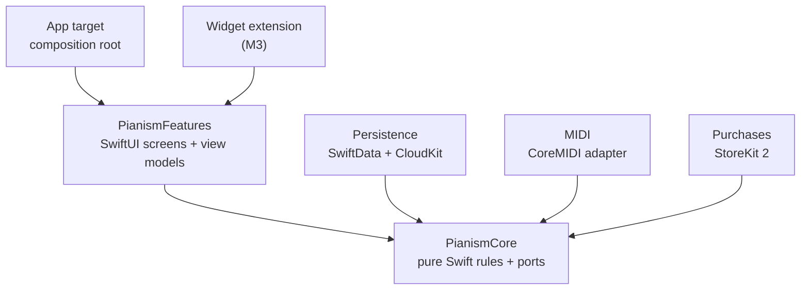

# Pianism

**A piano practice log that fills itself in.** Connect a digital piano and practice sessions start
and stop as you play. Built for distractible brains: one tap, no guilt, time always visible.

Status: **M0 Foundation** — project skeleton, CI and conventions. Not yet usable.

## Architecture



Arrows point at dependencies. The core imports nothing Apple-specific and is tested on Linux in CI,
which keeps that boundary honest. See [docs/adr](docs/adr) for the reasoning behind each decision.

## Getting started

Requirements: Xcode 26 or later (developed on Xcode 27), iOS 26+ iPhone and iPad simulators.

```sh
make test-core   # core unit tests, a few seconds
make test-app    # build the app and run end-to-end tests on iPhone and iPad simulators
make test-app DEVICES=iPhone   # just one, when iterating
make lint        # formatting check
```

Open `Pianism.xcodeproj` in Xcode to run the app. To run on a device, create
`Config/Local.xcconfig` containing `DEVELOPMENT_TEAM = <your team ID>` (it is git-ignored).

## Testing

| Layer | Runs |
| --- | --- |
| Unit (Swift Testing, core logic, injected clock) | Every PR, on Linux |
| Integration (SwiftData store, StoreKit) | Every PR |
| End-to-end (XCUITest in the simulator) | Every PR |
| Exploratory QA by an agent driving the simulator | Each milestone |
| Device checks with a real piano | Each milestone, by the owner |
