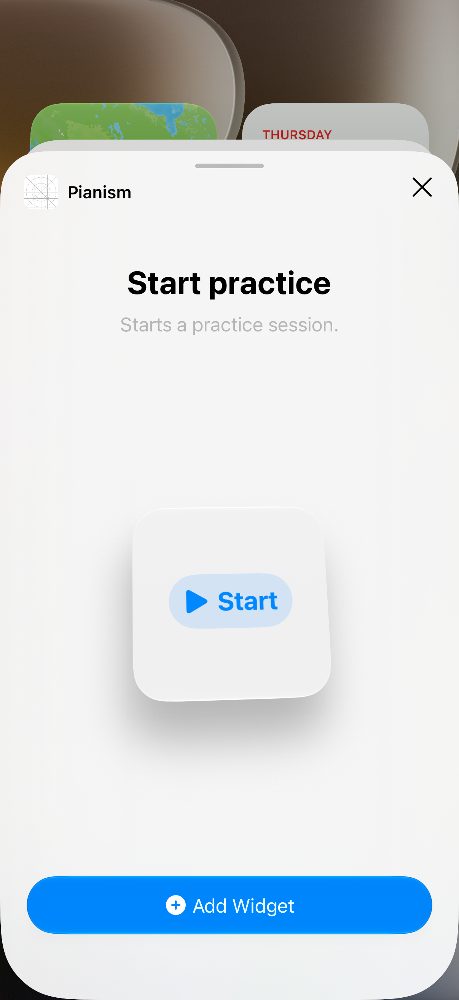

# Spike #17: a widget button starts a session and its Live Activity

Branch `spike-17-widget-live-activity`, not to be merged. Written 2026-10-16.

**Status: partly proven.**

- **Proven:** the widget extension builds, and the widget shows in the gallery with its Start button.
- **Not yet proven:** that tapping Start launches the app in the background, starts the session and shows the Live Activity. Automating the Home Screen on the iOS 27 simulator stalled, as described below.
- **To finish:** the 2-minute manual check at the end.

## What was built

| Part | Where | Size |
| --- | --- | --- |
| A widget extension target, added to the thin Xcode project | `project.pbxproj`, `Config/Widgets.xcconfig`, `Config/Widgets-Info.plist` | +132 lines, settings in xcconfig as usual |
| `StartPracticeIntent: LiveActivityIntent`: starts a session through `SessionRecorder` and the App Group file (ADR 0003), then calls `Activity.request` | `Shared/` (a synchronized folder in both targets) | 30 lines; no new core code |
| `PracticeAttributes` (the Live Activity's data: when the session started) | `Shared/` | 9 lines |
| A small "Start practice" widget with `Button(intent:)`, and the Live Activity (Lock Screen and Dynamic Island, with a `Text(timerInterval:)` clock) | `Widgets/` | 85 lines |
| `NSSupportsLiveActivities = YES` | `Config/App.xcconfig` | 1 line |
| A UI test that drives SpringBoard to add the widget and tap it | `AppUITests/WidgetSpikeTests.swift` | Spike only |

## What worked

- **Adding the target:** the extension target fits the project's conventions. It has a synchronized folder, settings in an xcconfig, and the same App Group entitlement file as the app. It linked the local packages, and the app and extension built for the simulator on the first try, with no warnings of ours.
- **One intent file for both targets:** the same file compiles into the app and the extension, through a shared synchronized folder.
  - `Activity.request` compiles in the extension too, so no `#if` is needed. I checked by building with and without one.
  - The extension only needs the type so its button can name it. Apple: "If you adopt the `LiveActivityIntent` … the system runs the app intent in the app's process."
- **The gallery:** the widget appears there as "Start practice: Starts a practice session." with its Start button rendered:

  

## What blocked the automated proof

Home Screen automation (`XCUIApplication(bundleIdentifier: "com.apple.springboard")`) worked for some steps but not reliably:

- **What worked:** a long press enters edit mode, and the "Edit" and "Done" buttons are found. The "Pianism" entry is found as a cell in the gallery.
- **What stalled:** before each tap, XCUITest checks for interrupting elements, which snapshots SpringBoard's whole accessibility tree. On the iOS 27 simulator that took about 17 minutes, three times, at different steps. Reading `springboard.debugDescription` never returned.
- **One button had no label:** the "Add Widget" button in the widget's sheet had no label any query matched, so only a tap by position could reach it.

**For the real implementation:** don't put widget or Live Activity flows in CI's end-to-end tests. Test the intent's logic through the core, which is all `SessionRecorder` today. Check the widget and the Live Activity by hand, with screenshots in the PR.

## What iOS restricts (Apple's documentation)

- A `LiveActivityIntent` runs in the app's process. The system "launches your app process without opening the app, performs the intent, and starts the Live Activity". A plain `AppIntent` would run in the extension.
- Widget buttons and toggles don't work on a locked device until the person unlocks it.
- A Live Activity can last 8 hours. After that it stays on the Lock Screen for up to 4 more hours, 12 hours at most. SES-4's 4-hour cap fits inside that.
- A Live Activity's static and dynamic data together can't exceed 4 KB, and the Live Activity has no network access.
- The app's Info.plist needs `NSSupportsLiveActivities`. The extension hosts the `ActivityConfiguration`.
- People can turn Live Activities off, for one app or for all, and then `Activity.request` throws.
  Check `ActivityAuthorizationInfo().areActivitiesEnabled` before asking.

## What the real implementation should do

1. **Keep this shape:** one widget extension target, the App Group entitlement shared with the app, and the intents in a folder compiled into both targets. Move the App Group name into one constant the app and the intents share.
2. **Make every Live Activity control a `LiveActivityIntent`** (Pause, Resume, Stop), each going through `SessionRecorder`. Each change also updates or ends the activity.
   - The app can be killed while an activity runs, so on launch it reconciles `Activity<PracticeAttributes>.activities` with the stored session.
3. **Keep the running clock off the update path.** `Text(timerInterval:)` counts on its own. Pausing needs an update that shows a fixed time.
4. **Decide one detail with SES-1 and SES-6:** if the app is in the foreground when the widget's intent runs, the Practice screen must refresh. It already refreshes when the app becomes active, but not while it's already active.
5. **Never fail a session because of its Live Activity.** The spike starts the session and then
   requests the Live Activity, so if Live Activities are off, the widget reports an error for a
   session that is running. Start the session first, request the Live Activity only when allowed,
   and treat a failed request as harmless: Practice still shows the session.
6. **Check a force-quit app.** Confirm on a device that the widget still starts a session after the
   app was swiped away. Apple's documentation says the system launches the app's process to run a
   `LiveActivityIntent`, but this spike didn't test it.
7. **Drop the spike's shortcuts:** `.now` in the timeline provider (the real one takes a clock, E3), the tap by position, and the hard-coded App Group string.

## The 2-minute manual check that finishes the spike

On the iPhone simulator:

1. From this branch, run the Pianism scheme once, then go to the Home Screen.
2. Long-press the Home Screen, then tap Edit, then Add Widget. Scroll to Pianism, tap Add Widget, then Done.
3. Tap Start on the widget.
   - **Expected:** the app does **not** open.
   - **Expected:** the Dynamic Island shows the piano icon and a running clock.
   - **Expected:** the Lock Screen shows "Practicing" with the clock.
4. Open Pianism. **Expected:** Practice shows "Practicing" with the same elapsed time.
5. Stop the session, swipe the app away, and tap Start on the widget again. **Expected:** the same as
   steps 3 and 4.
6. Turn Live Activities off for Pianism (Settings → Pianism → Live Activities), and tap Start again.
   **Expected with the spike's code:** the session starts, but the widget may show an error. This is
   the case point 5 above fixes.

On a device, the same steps need automatic signing to register `com.edkarabinus.Pianism.Widgets` under the team. That needs your Apple ID in Xcode.
